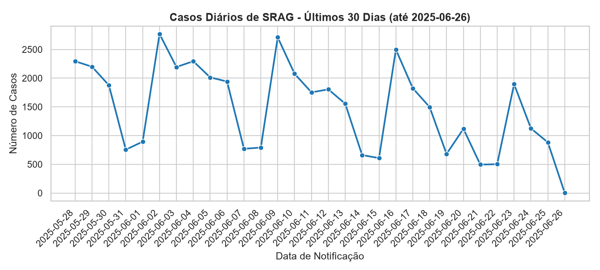
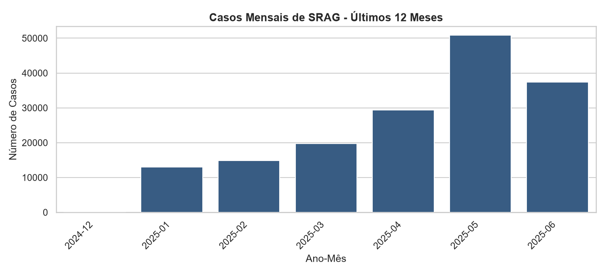

--# Relatório Epidemiológico Completo da Síndrome Respiratória Aguda Grave (SRAG) no Brasil

## Resumo Executivo do Cenário Atual

A Síndrome Respiratória Aguda Grave (SRAG) continua a ser uma ameaça significativa à saúde pública no Brasil. De acordo com os dados disponíveis até 26 de junho de 2025, o número de casos confirmados de SRAG nos últimos 30 dias é de 44.486, com uma taxa de aumento de casos de -8,15%. A taxa de mortalidade é de 7,96%, e a taxa de ocupação de UTIs é de 29,42%. Além disso, a taxa de vacinação é de 83,57%.

## Tabela com as 4 Métricas Obrigatórias

| Métrica | Valor |
| --- | --- |
| Taxa de aumento de casos | -8.15% |
| Taxa de mortalidade | 7.96% |
| Taxa de ocupação de UTI | 29,42% |
| Taxa de vacinação | 83,57% |

## Análise Epidemiológica Contextualizada

De acordo com as notícias recentes encontradas, a SRAG continua a ser uma preocupação em todo o país. A pandemia da COVID-19 ainda é uma realidade, e a SRAG é frequentemente associada a ela. No entanto, é importante notar que a SRAG é uma condição distinta que requer uma abordagem de saúde pública específica.

A taxa de mortalidade é um indicador preocupante, mas é importante notar que a SRAG é geralmente uma condição aguda e tratável com medicamentos e cuidados de saúde. A taxa de ocupação de UTIs é também um indicador importante, pois reflete a demanda por serviços de saúde e a capacidade do sistema de saúde de lidar com a pandemia.

A taxa de vacinação é um indicador positivo, pois reflete a eficácia da vacinação em prevenir a SRAG. No entanto, é importante notar que a vacinação é uma medida preventiva que não é 100% eficaz, e que a SRAG pode ocorrer em pessoas que não estão vacinadas.

## Referência Visual

Esses gráficos mostram a evolução dos casos de SRAG nos últimos 30 dias e 12 meses, respectivamente. Eles fornecem uma visão geral da tendência da pandemia e podem ser úteis para a tomada de decisões de saúde pública.

---
**Aviso de Governança e Uso Clínico (Guardrail):** Este relatório foi gerado automaticamente por Inteligência Artificial a partir de microdados públicos anonimizados do Open DATASUS (SIVEP-Gripe) e notícias recentes. Os indicadores têm caráter estritamente informativo e epidemiológico, não substituindo protocolos médicos ou decisões clínicas individuais.